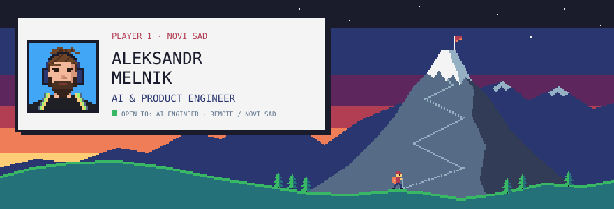
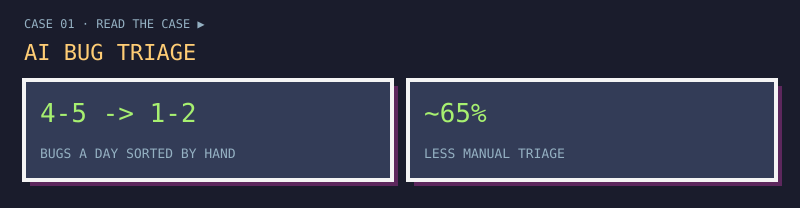
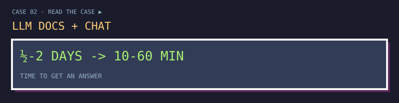
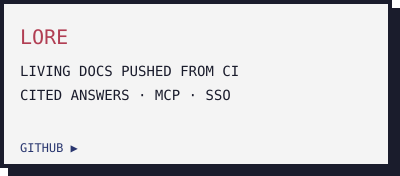
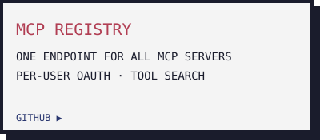
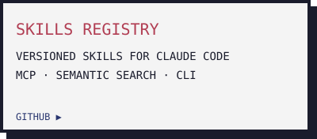
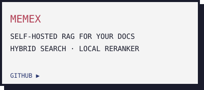
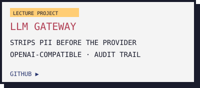
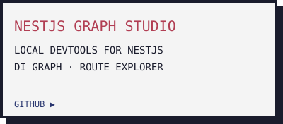
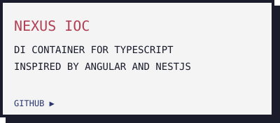

  

10+ years building the foundations of banking, payments and SaaS products, now with AI in the loop. I build AI systems that save a team real time, and the self-hosted tooling that keeps them inside your own perimeter. Led teams of up to 13. More on **[tech-pioneer.info](https://tech-pioneer.info)**.

  
  

  
  
  
  
  
  
  

TypeScript, React, Next.js, Node.js · Python, FastAPI · Postgres + pgvector · Claude Code, MCP, embeddings and RAG · Docker, self-hosting

  
  
  

